# 摸鱼笔记本

> 上班可以摸，笔记不能丢。

一个只存在本机的收集本。网址、账号、随手想到的事，一天一页的日记，按来源分的笔记，一个标题一张大纸的计划，还有日 / 周 / 月 / 年都能看的日程。

## 下载与安装

发布页：**<https://github.com/Tea-2026/moyu-notebook/releases/latest>**

- **安装包**：`Moyu-3.3.2-win-x64-setup.exe`。按当前用户安装到 `%LOCALAPPDATA%\Programs\Moyu`，不需要管理员权限；卸载不会删 `%LOCALAPPDATA%\Moyu` 里的数据。
- **便携版**：`Moyu-3.3.2-win-x64-portable.zip`，解压后直接运行 `Moyu.exe`。
- **零安装网页版**：`Moyu-3.3.2-standalone.html`，双击用浏览器打开；它和桌面版的数据不互通。
- **校验**：每个版本附 `SHA256SUMS.txt`。

安装包自带 .NET 8 运行时；需要 Windows 10 1809+ x64 和 Microsoft Edge WebView2 Runtime（Windows 11 和装过新版 Edge 的机器一般已有）。

> 安装包目前没有代码签名。Windows SmartScreen 可能显示「未知发布者」；点「更多信息」→「仍要运行」，或者改用便携版。请只从本仓库的 Releases 下载，并核对 SHA256。

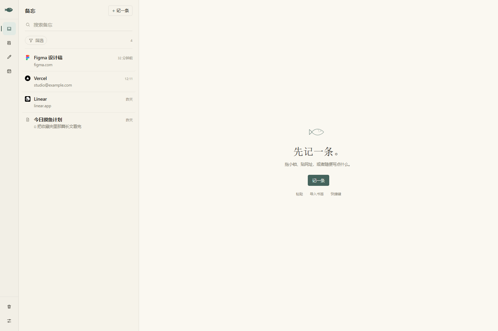

## 活动栏

最左侧是一条窄活动栏，像编辑器那样只放图标：

- **备忘**：现在能用的部分，网址、密码、随手记都在这里。
- **日记**：左边小日历，下面是本月日记；点日子就跳过去写。
- **笔记**：按书、诗、题建文件夹，书下面还能再分章节。
- **计划**：一个标题，一张很大的纸；左边总览所有计划。
- **日程**：日、周、月、年四个视角；有时间的日程会按上午 / 下午分开。
- **纸篓**：独立的恢复页，备忘、日记、笔记、日程都能在这里找回来。
- 品牌鱼回到备忘；纸篓、上锁、设置在活动栏底部。
- 鼠标停在图标上会显示名称。

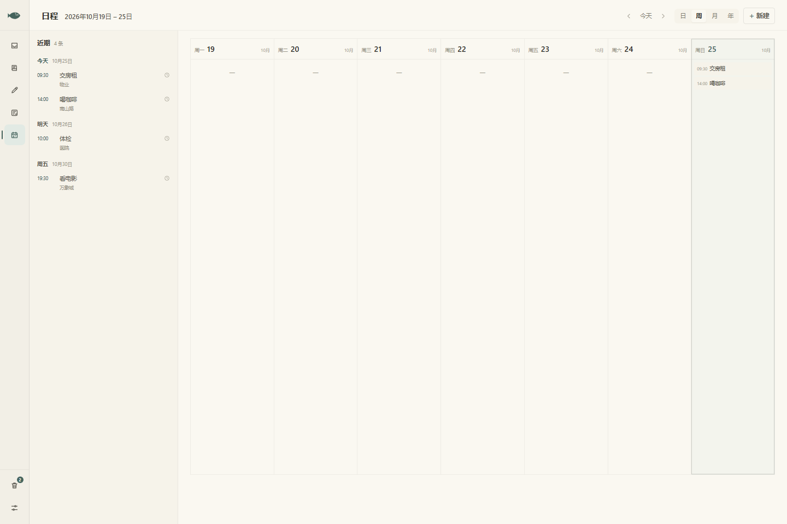

## 日记

日历放在日记侧栏，过一天点一格。写过日记的日子下面有一个小点，今天有圈，选中的日子会填色；未来的日子不能提前写。

- 默认停在今天，也可以点过去的日子补写。
- 标题可写可不写，正文自动保存。
- 侧栏下面是本月日记，点一条也能跳回那一天。
- 右上角可以导出这一天的 Markdown，或者删掉这篇；删除可以撤销。
- 设置 → 数据 可以导出全部日记 `.md`；JSON 备份里也会带日记。

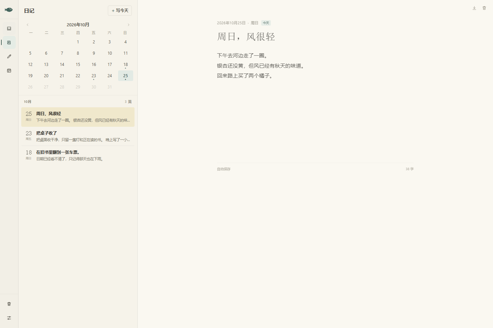

## 笔记

左侧是一棵像书签一样的文件夹树：顶层可以是「一本书」「一本诗集」「一类题」，下面继续分「第一章」「李白」「极限」都没问题。

- 文件夹可以新建、改名、往下嵌套；删除文件夹时笔记会移到上一级，不会丢，还能撤销。
- 文件夹可以直接拖：拖到另一个文件夹中间就变成它的子文件夹，拖到上 / 下边缘可以调顺序，拖到底部的「移到顶层」回到顶层。
- 「全部笔记」看所有，「未分类」放还没归类的；点文件夹会把它和子文件夹里的笔记一起列出来。
- 每条笔记有标题、正文、一个可选的「页码 / 位置」，以及自己的来源文件夹。
- 来源下拉框可以直接把笔记挪到别的文件夹；标题和正文自动保存。
- 右上角可以导出单条 Markdown；设置 → 数据 可以导出全部笔记 `.md`。
- JSON 备份里包含文件夹和笔记；Markdown 始终是明文。

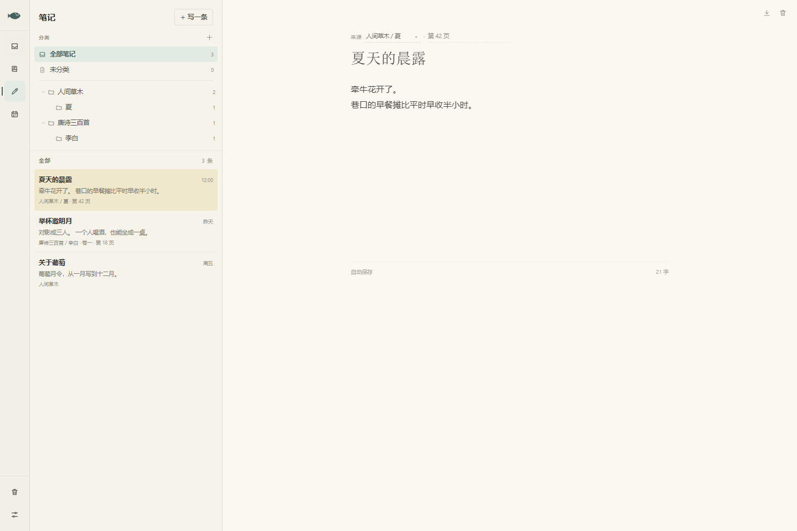

## 计划

计划不拆步骤、不做看板。一个计划就是一个标题，加一张很大的纸。

- 左侧列出所有计划，按最近修改排序；点一条就打开。
- 标题可以不写，正文自动保存。
- 右上角可以导出单个计划 Markdown，或者删掉（进纸篓，可恢复）。
- 设置 → 数据 可以导出全部计划 `.md`；JSON 备份里也包含计划。
- 计划 Markdown 是明文。

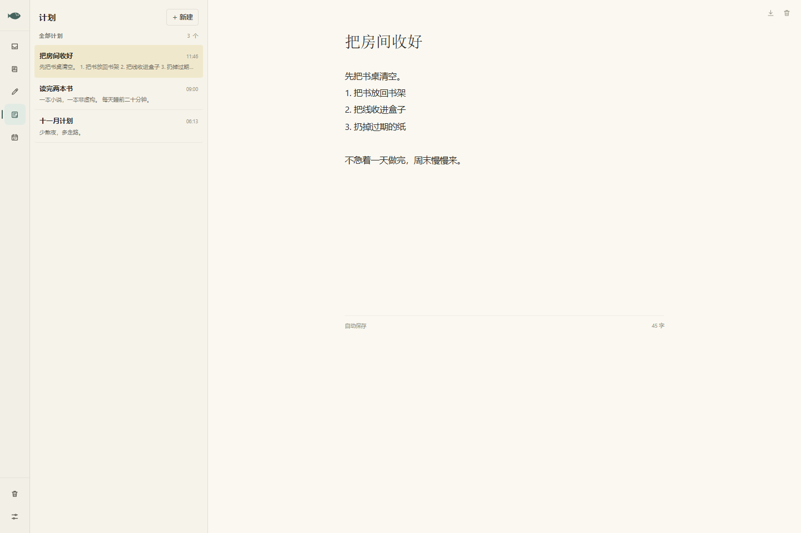

## 右键菜单

桌面版里，常用条目都可以右键：

- **备忘**：打开、复制标题 / 正文 / 链接、置顶、移到纸篓。
- **笔记**：笔记卡可以打开、复制、导出、删掉；文件夹可以新建子文件夹、重命名、移到顶层、删除。
- **计划**：打开、复制标题 / 正文、导出 Markdown、移到纸篓。
- **日程**：编辑、复制标题 / 时间、删掉；在空白日期上右键可以直接在这天新建。
- **日记**：打开这天、复制正文、导出、删掉。
- **纸篓**：恢复、复制标题、彻底删除。

浏览器的默认右键菜单已经关掉了，不会再出现「返回 / 刷新 / 另存为 / 打印」。输入框和正文里右键会是应用自己的 **剪切 / 复制 / 粘贴 / 全选 / 清空**；空白处只留当前页面的「新建」和「设置」。菜单支持方向键和 `Esc`。

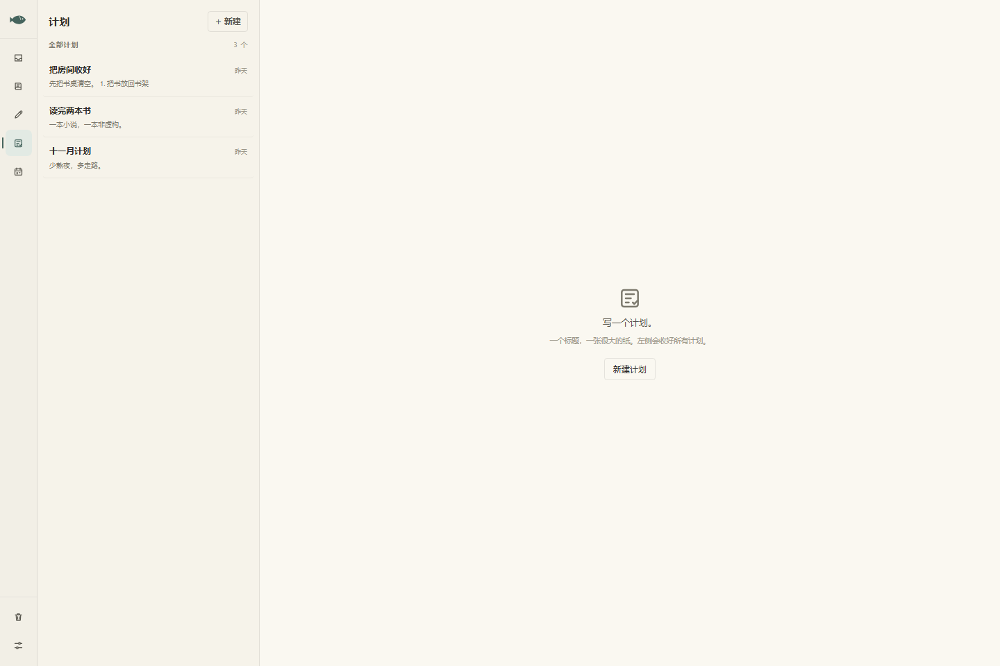

正文里的右键：

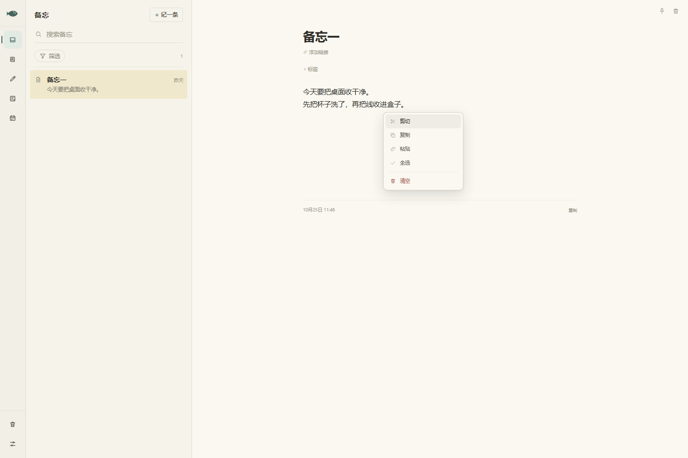

## 日程

日程页左侧是一条窄的「近期」栏，右边留给日历。顶部可以切换 **日 / 周 / 月 / 年**，左右箭头按当前视角翻页。

- 左侧「近期」把今天和以后的日程按日期、时间由近到远排好；点日期跳到那天的日视图，点日程直接编辑。手机上点右上角的收件箱图标，会打开全屏的近期列表。
- **日**：分成「全天」「上午」「下午」三层。填了时间的日程按 12 点分到上午或下午，并显示具体时间。
- **周**：周一到周日七列，每天列出全部日程；点日期标题进日视图。
- **月**：一整月的格子，每天最多露出三条，更多收在「还有 N 条」里。
- **年**：十二个月块，按月列出这个月所有日程；点月份标题进月视图。
- 新建时只要求标题和日期，时间可以不填。不填就是全天日程。
- 每条日程可以写地点和备注；提醒可以选不提醒、准时、提前 5 / 10 / 30 分钟、1 小时或 1 天。
- 桌面版在托盘里运行时，会通过 Windows 通知提醒；全天日程的「准时」按当天 09:00 算。点通知会打开日程页。退出程序后不会响。
- 设置 → 数据 可以把全部日程导出成 `.ics`，拖进系统日历或其他日历应用也能用；JSON 备份里包含日程。

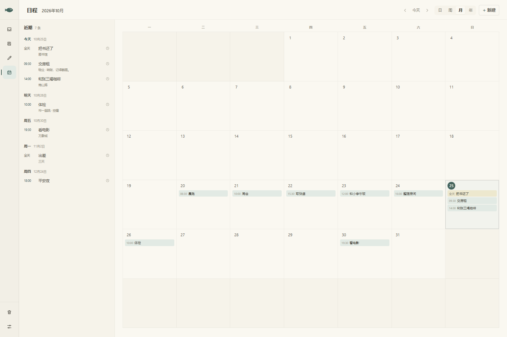

| 日视图 | 周视图 |
| --- | --- |
| 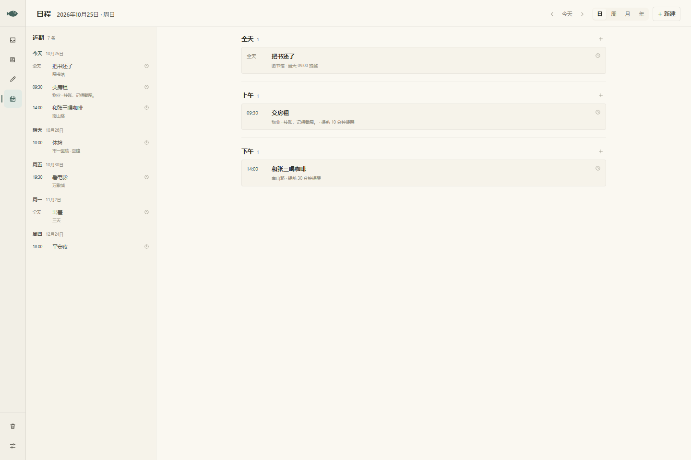 | 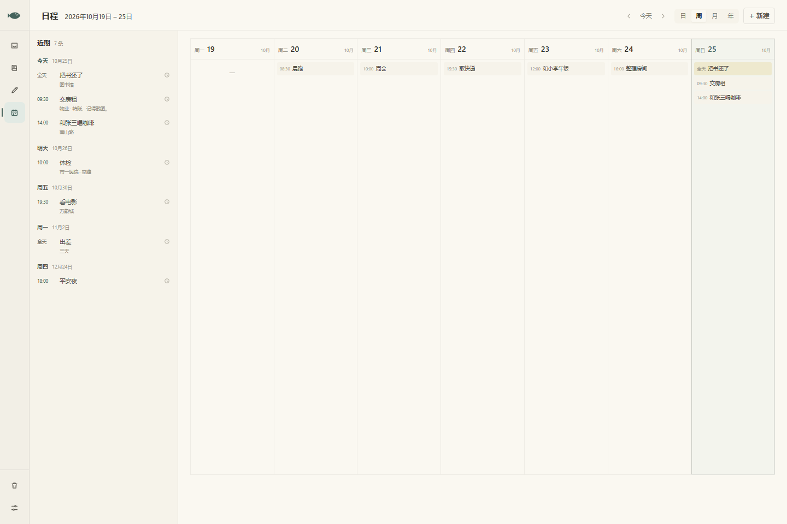 |

| 年视图 | 新建日程 |
| --- | --- |
| 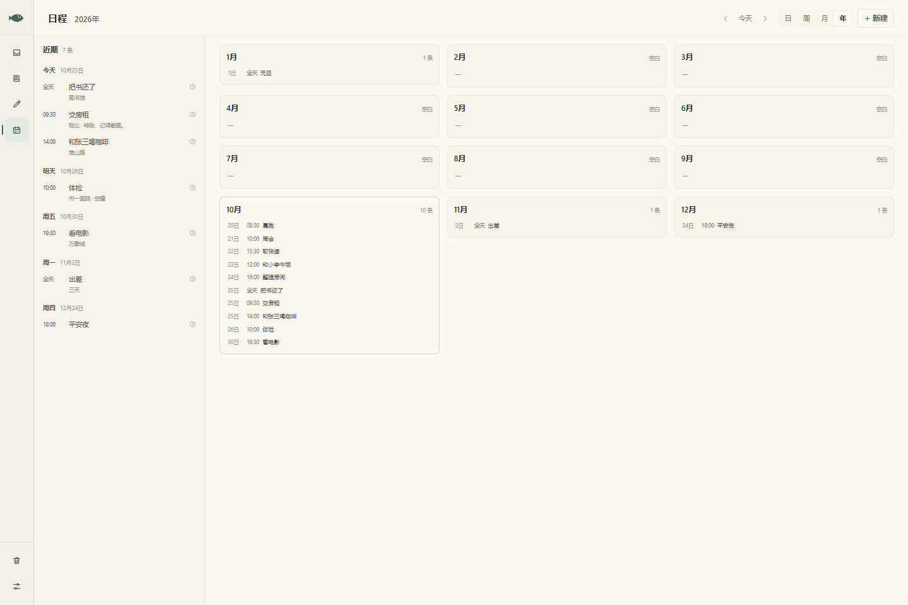 | 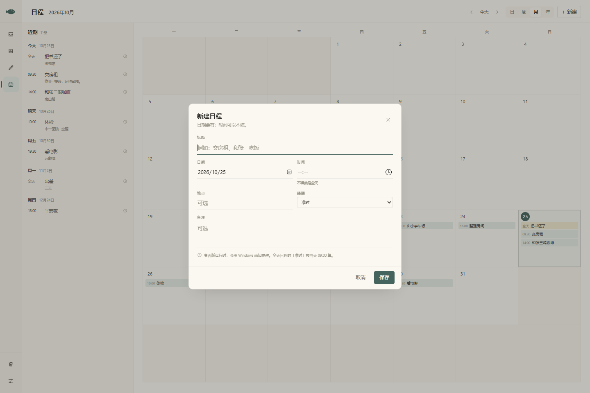 |

## 纸篓

纸篓现在是独立的一页，不再只是备忘列表里的一个筛选。

- 备忘、日记、笔记、日程删掉后都会先来这里，顶部按类型分页。
- 每条都可以「恢复」或「彻底删除」；右上角可以一次清空。
- 日记同一天已经有另一篇时，恢复会先提示，不会覆盖。
- 纸篓里的东西仍然在 JSON 备份和加密库里；彻底删除后才会消失。

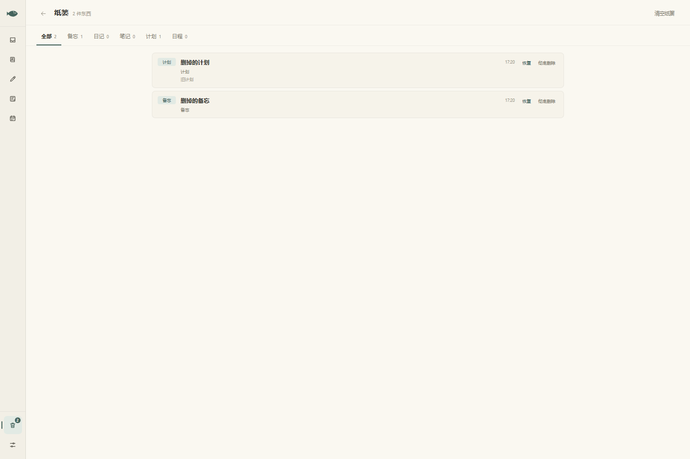

## 用起来

**Windows 桌面版（推荐）**

从 [Releases](https://github.com/Tea-2026/moyu-notebook/releases/latest) 下载安装包，按当前用户装进 `%LOCALAPPDATA%\Programs\Moyu`；也可以下载便携 ZIP 解压即用。

- `Ctrl + Alt + N` 从任何窗口唤起速记。
- 关窗不退出，收进系统托盘；右键托盘图标退出。
- 更新：退出托盘图标后，再运行新版本安装包；数据不会被覆盖。

**零安装单文件**

从 Releases 下载 `Moyu-3.3.2-standalone.html`，双击用 Edge / Chrome 打开。和桌面版数据相互独立。

**iPhone / iPad**

先运行 `python tools/build_standalone.py` 生成 `dist\web`，把它部署到任意 HTTPS 静态托管，Safari 打开 →「添加到主屏幕」。配合快捷指令，可以从 Safari 直接丢一条进来。

## 怎么记

- **拖小锁**：按住地址栏左侧的小锁，拖进窗口，松手。
- **拖别的**：标签页、书签、页面里的链接、选中的文字，都能拖。
- **多个链接**：一次拖进来，会一起收好，共用标签和备注。
- **快捷键**：`Ctrl + Alt + N`（桌面版），或点列表顶部的「记一条」。
- **书签导入**：设置 → 记录 → 导入浏览器书签。
- **书签工具**（网页版）：设置 → 记录 → 书签工具，把按钮拖到书签栏。

收页窗口里可以顺手写标题、标签、备注；标题留空就用域名。收好之后还能继续改。

## 右下角的小窗

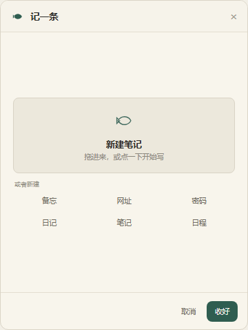

桌面版运行后，屏幕右下角（任务栏上方）会常驻一条很细的鱼尾。按住鱼尾可以拖到桌面任意位置，靠近屏幕边缘会平滑吸附，位置会记住；靠左右两侧是竖的，靠上下两侧是横的，离开边缘会缩成圆形。点一下会从鱼尾所在的位置展开，展开后按住顶部标题栏可以拖动小窗；标题或正文里已经有字时，它不会自己收起；拖内容过去也会展开：

- **新建**：空着的时候点「新建笔记」，写标题、备注、标签，`Ctrl + Enter` 收好；下面还可以直接选「备忘 / 网址 / 密码 / 日记 / 笔记 / 日程」，会把主窗口打开到对应入口。
- **拖进来**：文字、链接、网页图片、音频链接、本地图片 / 音频文件；拖入不经过选择菜单，纯文字默认备忘，链接和文件按内容收好。
- 展开和收起是 220ms 的缩放 + 淡入淡出，不抢前台焦点。
- 网页图片和音频默认只存链接；本地文件会复制到 `%LOCALAPPDATA%\Moyu\files`，原文件挪走也不影响。
- 托盘右键 →「右下角小窗」可以关掉；「打开右下角小窗」可以随时叫出来。
- 不支持 `edge://` 内置页、PDF 阅读器；网页播放器本身多数不能拖，拖音频链接或本地文件最稳。

## 备忘里的三种记录

| 类型 | 放什么 | 多出来的 |
| --- | --- | --- |
| 网站 | 想稍后看的页面、参考、灵感 | 打开原网页、复制链接、网站图标 |
| 密码 | 账号、密码 | 显示 / 复制、随机密码、强度提示、同密码共用提示 |
| 备忘 | 待办、摘录、一句话 | 自动保存、全文复制 |

列表顶部不再单独放标签栏。点「筛选」，可以按类型、标签、置顶、有附件、最近 7 天组合筛选；选中的条件会变成一排小标签，点叉就能去掉。

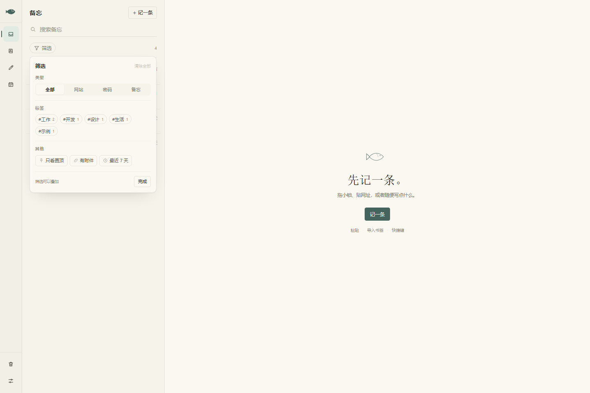

## 快捷键

| 键 | 动作 |
| --- | --- |
| `Ctrl + Alt + N` | 从任何窗口唤起（桌面版） |
| `Ctrl + N` / `Alt + N` | 记一条（桌面版 / 网页版） |
| `Ctrl + Shift + Space` | 应用内速记 |
| `Ctrl + K` | 搜索 |
| `Ctrl + Enter` | 在速记窗口里记下 |
| `Ctrl + Shift + L` | 上锁（开启密码锁后） |
| `↑` `↓` | 切换记录 |
| `Esc` | 关闭 / 返回 |
| `?` | 快捷键表 |

## 数据与锁

- 没有账号，没有云端。记录、日记、笔记、计划和日程只写在本机。
- 桌面版数据在 `%LOCALAPPDATA%\Moyu\WebView2`。
- **自动备份**：普通内容每次保存后写到 `文档\摸鱼笔记本备份\latest.json`，每 10 分钟另留一个快照，最多保留 24 个；日记、笔记文件夹、笔记、计划和日程也在这个 JSON 里。删掉 `D:\App\Moyu` 不会删这些备份。
- 纸篓里的内容仍在 JSON 备份里，彻底删除后才移除；有密码记录（包括纸篓里的）且未上锁时，自动备份仍然暂停。
- **有密码且未上锁时，自动备份会暂停**，避免在文档里多留一份明文密码；开启密码锁后恢复，备份为密文，日记、笔记和日程也一起加密。
- 设置 → 数据，可以导出 / 导入 JSON 备份、导出全部日记 / 笔记 / 计划 `.md`、导出日程 `.ics`、立即备份、打开数据 / 备份文件夹。
- 托盘右键 →「打开备份文件夹」也能直接打开。
- 可选的密码锁：整库 AES-256-GCM，密码经 PBKDF2-SHA256 派生，只存在内存里。开启后自动备份也是密文，导入时会问密码。
- 忘记密码无法找回；未上锁时手动导出的 JSON 是明文，含密码字段；日记 / 笔记 / 计划 Markdown 和日程 `.ics` 始终是明文，不受密码锁保护。
- 硬盘损坏无法靠软件保证；重要内容建议再导出一份到别的盘或云盘。

## 为什么长这样

上一版被说「AI 味有点重」。这次做了几件具体的减法：

- 删掉顶部工具条、旧标签侧栏、卡片边框、渐变、玻璃效果、装饰插画、三张等宽功能卡、满屏小徽章。
- 旧的标签侧栏换成一条窄活动栏：上面是功能空间，下面是纸篓和设置；目录和正文保持安静。
- 日记没有另起一套花哨的 dashboard：一张小日历、一列本月日记、一张纸，够用了。
- 笔记用书签式文件夹树，而不是给每条笔记塞一堆标签：一本书、一章、一道题，本来就有层级。
- 日程不做成一张永远填不满的月历：日、周、月、年各自回答一个不同的问题，想细看就往下钻一层。
- 只留三层：活动栏、目录（列表）、正文。标签筛选收进目录顶部的一个「筛选」按钮。
- 一个主操作（记一条），一个入口（筛选），一个强调色（墨绿）加一支荧光笔。
- 空状态只留一条鱼、一句话、一个按钮，不再解释产品理念。
- 文案按「一个用来自嘲的小本子」写，不按 SaaS 落地页写。

参考资料：

- [优设：AI 味到底是什么？](https://www.uisdc.com/ai-flavor)
- [优设：AI 做网页总是蓝紫渐变？](https://www.uisdc.com/escape-ai-templates)
- [NN/g：Whitespace](https://www.nngroup.com/videos/whitespace/)
- [NN/g：Managing Visual Complexity](https://www.nngroup.com/videos/managing-visual-complexity/)
- [NN/g：Progressive Disclosure](https://www.nngroup.com/articles/progressive-disclosure/)
- [Vandelay：Why AI-Generated Designs Look the Same](https://www.vandelaydesign.com/why-ai-generated-designs-look-the-same/)

## 给 AI / 脚本用

桌面版内置一个只监听本机的 HTTP API，命令行 `moyu` 是它的薄封装。

1. 设置 → **连接** → 新建凭证。
2. 勾「读取」和 / 或「修改」，创建后复制密钥；之后在凭证列表里随时可以再点「复制」。
3. 在终端里：

```powershell
$env:MOYU_API_KEY = "你的密钥"
moyu --help
moyu summary
moyu notes list --limit 20
```

安装包默认把 `%LOCALAPPDATA%\Programs\Moyu` 加进用户 PATH（安装时取消勾选就不加）；便携版可以用 `D:\App\Moyu\moyu --help` 或手动把目录加进 PATH。

- 密钥是 40 位 `A-Za-z0-9`，用 Windows DPAPI 按当前用户加密保存在本机，可以反复复制；服务端校验时只比对 SHA-256 哈希。名字可以改，密钥不能改。换 Windows 账户或换机器后旧密钥文件无法解密，删除重建即可。
- 凭证可以随时停用 / 删除；停用后立刻失效。
- 「读取」只能查，「修改」才能增删改；改权限需要新建凭证。
- API 只绑定 `127.0.0.1`，程序退出就停止；库上锁时返回 `423`。
- **不会返回密码内容**；密码记录只返回标题、账号、网址等元数据。
- 支持备忘、日记、笔记、文件夹、计划、日程和纸篓；写操作走原来的保存 / 自动备份流程。

完整命令、HTTP 接口和安全边界见 [docs/api.md](docs/api.md)。

## 实现

- 网页：原生 HTML / CSS / JavaScript，零依赖；PWA 支持离线。
- 桌面：WPF + WebView2，自绘 Windows 标题栏、托盘、全局热键、开机启动、日程通知。
- 图标：一条鱼。低饱和的墨绿和米白，没有渐变。

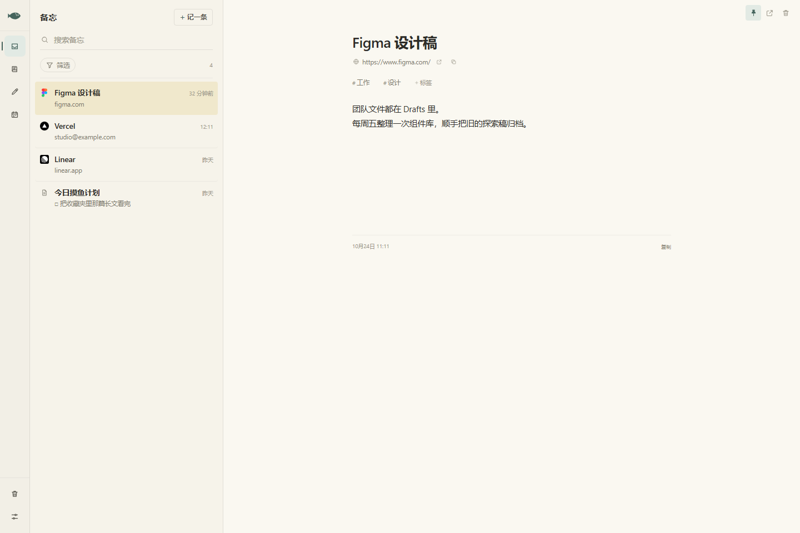

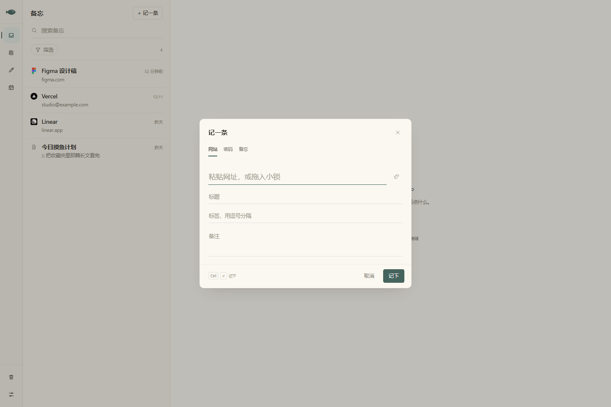

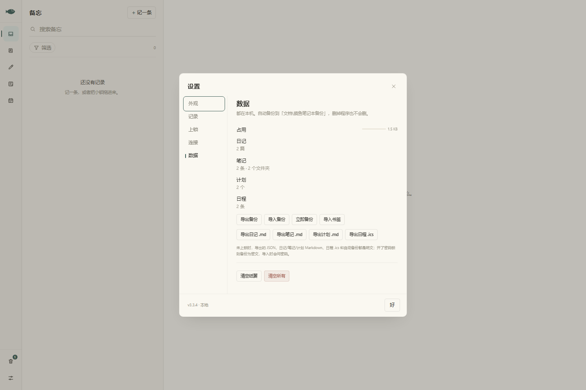

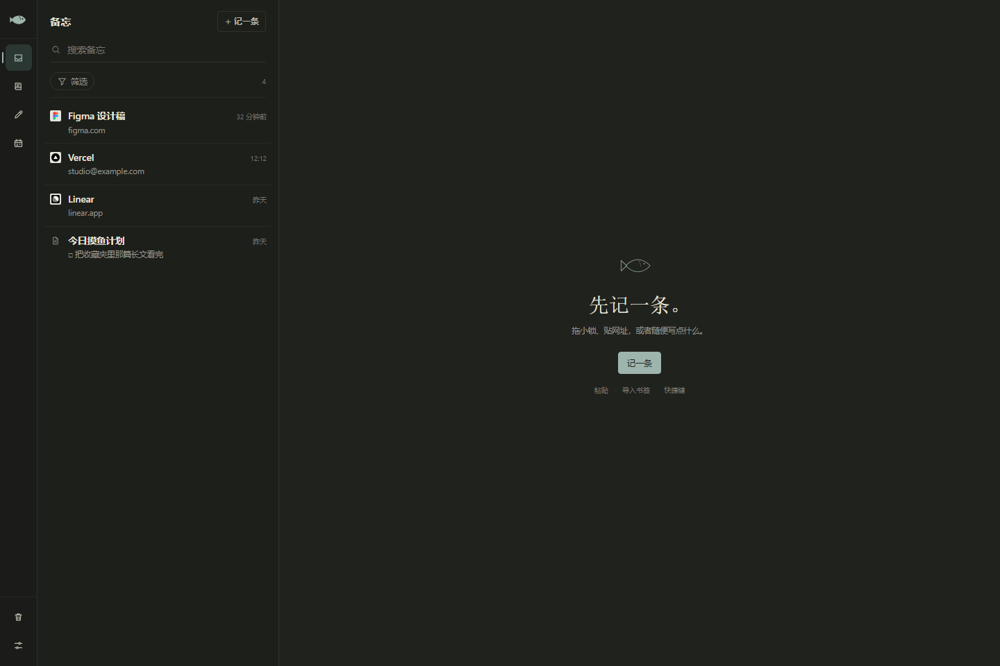

<p align="center">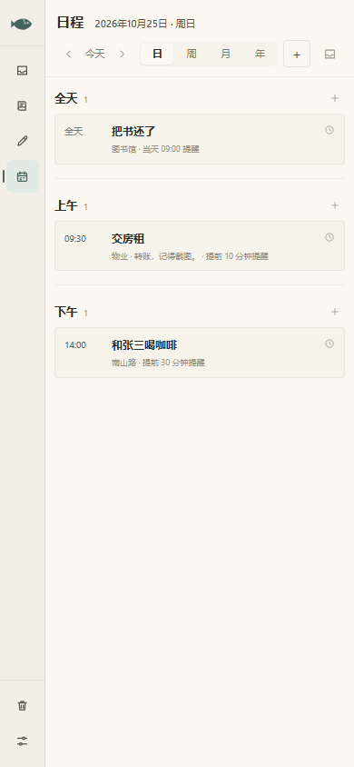</p>

## 自己构建

需要 .NET 8 SDK、Python 3.10+，以及可选的 Inno Setup 6 和 7-Zip。Windows 端还需要 WebView2 Runtime（装过 Edge 一般就有）。

```powershell
# 开发版：框架依赖，输出到 dist\win
powershell -ExecutionPolicy Bypass -File tools\build.ps1

# 发布版：自包含应用、便携 ZIP、安装包
python tools\build_standalone.py
powershell -ExecutionPolicy Bypass -File tools\build-release.ps1
```

发布脚本的输出在 `dist\release`。安装包是**按用户安装**，不需要管理员权限；详细发布流程见 [docs/releasing.md](docs/releasing.md)。

## 边界

- 当前机器是 Windows 10，界面按 Win11 的视觉语言设计；Win11 上用系统 DWM 圆角，Win10 上用窗口区域裁出 12px 圆角，边缘会比 Win11 略硬。
- 发布安装包自带 .NET 8 运行时；从源码跑的开发版是框架依赖，需要 .NET 8 Desktop Runtime。
- 安装包未签名，首次运行可能触发 SmartScreen；介意的话用便携版或自己构建。
- 全局快捷键被占用时，会尝试 `Ctrl + Alt + Space` / `Ctrl + Alt + J`。
- 拖小锁取决于浏览器，Chrome / Edge 最稳；拖不动就拖标签页或直接粘贴。
- 日程提醒只在桌面版运行（包括收在托盘里）时有效；程序退出后不会由 Windows 补发。
- 没有跨设备同步，换设备用导出 / 导入。

## 许可证

[MIT](LICENSE)。第三方组件见 [THIRD-PARTY-NOTICES.md](THIRD-PARTY-NOTICES.md)。

---

摸一会儿，记一条。
